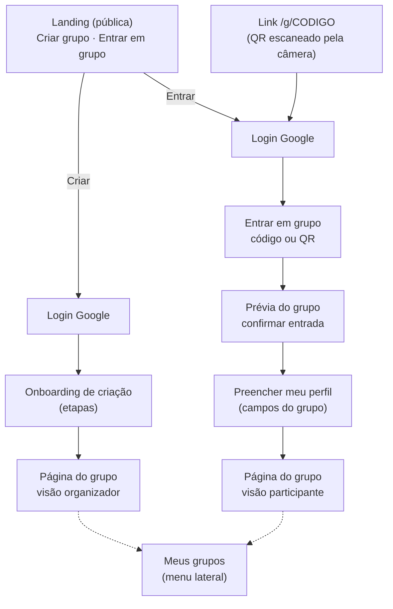

# Amigo Secreto — Produto e Plano de Testes para o Pluto

> O app de amigo secreto é um **piloto da stack do Pluto**: pequeno o bastante para ficar pronto rápido, mas com os mesmos problemas difíceis. Este documento define o produto (fluxos, telas, modelo de dados, permissões) e o que cada parte valida para o Pluto.
>
> Referências: `pluto-especificacao.md` e `instant-infra-etapa-zero.md`.
>
> Última atualização: 2026-11-20 (v2: grupos temáticos, campos de perfil configuráveis, entrada por código/QR, navegação).

---

## 1. Por que o amigo secreto é um bom piloto

O coração do amigo secreto é **segredo por usuário**: cada pessoa só pode ver quem ela tirou, e nem o organizador pode ver o sorteio. É a mesma garantia que o Pluto precisa para separar o plano de cada pessoa, e mais tarde os pacientes de cada Nutri.

O sorteio **não pode rodar no navegador** (quem rodasse veria tudo), então obriga a construir o padrão "worker no servidor reagindo a um pedido" que os agentes do Pluto vão usar.

E os **campos de perfil configuráveis por grupo** (seção 3.4) exercitam o mesmo problema da modelagem flexível do plano alimentar: estrutura definida em dados, não no código.

---

## 2. Visão do produto

Um app para organizar amigos secretos **temáticos**. Exemplo motivador: um **amigo livro**, em que cada participante conta quais livros leu recentemente e de que gêneros gosta, para evitar presente repetido ou fora do gosto.

Princípios:
- O organizador também é participante.
- Cada grupo define **o que os participantes informam** sobre si (campos de perfil), a partir de um tema.
- Ninguém vê quem os outros tiraram — nem o organizador.
- Uma pessoa pode organizar e participar de vários grupos ao mesmo tempo.

Domínio sugerido: `amigo.tpou.gy`.

---

## 3. Fluxos e telas

### 3.1 Mapa de navegação



### 3.2 Landing (pública)

- Explica o app em uma frase e mostra **dois botões**: **Criar um grupo** e **Entrar em um grupo**.
- Ambos exigem login com Google; a landing em si não.
- **Preservar a intenção através do login:** antes de redirecionar para o Google, guardar a ação pretendida (criar / entrar com código X) em `sessionStorage`; ao voltar, o app retoma de onde a pessoa estava. Sem isso, quem clicou em "entrar" cai numa tela genérica e se perde.
- Usuário já logado que abre a landing vai direto para **Meus grupos**.

### 3.3 Criar grupo (onboarding em etapas)

| Etapa | Conteúdo |
|---|---|
| 1. Tema | Escolher um tema: **Livro**, **Livre**, **Vinho**, **Personalizado**… O tema é um *template*: pré-preenche os campos de perfil da etapa 4 |
| 2. Sobre o grupo | **Título** e **descrição** |
| 3. Datas e regras | **Data prevista do sorteio**, **data do evento**, valor sugerido (opcional) |
| 4. Campos do perfil | O que cada participante vai informar. Vem pré-preenchido pelo tema; o organizador adiciona, remove, reordena e marca como obrigatório |
| 5. Revisão | Resumo; confirmar cria o grupo |
| 6. Compartilhar | Mostra **código**, **QR Code** e **link**, com botão de compartilhar (Web Share API no celular) |

Depois disso, o organizador cai na página do grupo e é convidado a **preencher o próprio perfil** (ele também participa).

**Exemplo — tema Livro:**

| Campo | Tipo | Obrigatório |
|---|---|---|
| Livros que li recentemente | Lista de itens | Não |
| Gêneros que mais gosto | Múltipla escolha (fantasia, romance, suspense, não ficção, clássicos…) | Sim |
| Livros que já tenho / não quero ganhar | Lista de itens | Não |
| Observações para quem me tirar | Texto livre | Não |

Lista de desejos **não** faz parte do tema Livro (por decisão de produto: é específica demais). Ela pode existir como campo opcional em outros temas, se o organizador quiser.

### 3.4 Campos de perfil configuráveis

Tipos suportados na primeira versão:

| Tipo | Valor guardado |
|---|---|
| Texto curto | string |
| Texto longo | string |
| Lista de itens | array de strings |
| Múltipla escolha | array de opções definidas pelo organizador |
| Escolha única | uma opção |

- O organizador pode editar os campos depois de criado o grupo. Remover um campo com respostas pede confirmação; renomear não apaga respostas.
- As respostas de um participante são visíveis **só para ele e para quem o tirou** (depois do sorteio).

**Valor para o Pluto:** é o mesmo padrão de "estrutura definida em dados" que o plano alimentar flexível vai precisar (opções, porções e substituições variam por pessoa). Validar aqui como o Instant lida com valores JSON, validação e evolução desses campos.

### 3.5 Entrar em um grupo

Duas formas:
1. **Digitar o código** do grupo.
2. **Escanear o QR Code.**

Sobre o QR: o mais simples e robusto é o QR conter o **link** `https://amigo.tpou.gy/g/CODIGO`. Assim a pessoa escaneia com a **câmera do próprio celular**, sem abrir o app antes. O botão "Escanear QR" dentro do app continua útil (ex.: no desktop com webcam), usando a `BarcodeDetector` API onde existir, com uma biblioteca de fallback.

Fluxo após informar o código:
1. **Prévia:** título, descrição, tema, organizador, datas e número de participantes.
2. **Confirmar entrada.**
3. **Preencher meu perfil** com os campos do grupo.
4. Página do grupo (visão participante).

Regras: não é possível entrar depois do sorteio, nem duas vezes no mesmo grupo.

### 3.6 Código do grupo

Requisitos: fácil de ditar e digitar, difícil de adivinhar, único.

Proposta:
- **6 caracteres**, exibidos como `KQ7-M4P`.
- Alfabeto sem vogais e sem caracteres ambíguos: `BCDFGHJKMNPQRSTVWXZ23456789` (27 símbolos). Sem vogais, nenhum código forma palavra; sem `0/O`, `1/I/L`, ninguém confunde.
- Entrada tolerante: aceita minúsculas e ignora hífen e espaços.
- Gerado no cliente ao criar o grupo e gravado num atributo **único e indexado**. Se colidir, o servidor recusa com `record-not-unique` e o cliente gera outro.

Por que não 4 letras: com 4 caracteres há poucas centenas de milhares de combinações, e o código funciona como uma **chave de acesso**: quem adivinha, entra. Com 6 caracteres são centenas de milhões. Somado a um **rate limit** nas tentativas de entrada e ao fechamento do grupo após o sorteio, adivinhar deixa de ser viável.

### 3.7 Página do grupo — visão do organizador

Abas ou seções:

| Seção | Conteúdo |
|---|---|
| Participantes | Lista ao vivo de quem entrou e se já preencheu o perfil. Remover participante (antes do sorteio) |
| Meu perfil | O organizador preenche o próprio perfil |
| Sorteio | Contagem de participantes, data prevista, restrições opcionais (ex.: casais não se tiram), botão **Sortear**. Depois do sorteio: status e data — **sem mostrar os pares** |
| Configurações | Editar título, descrição, datas, campos; ver código/QR; encerrar grupo |

Ações pós-sorteio: **refazer sorteio** (com confirmação e limite), por exemplo se alguém precisou sair.

### 3.8 Página do grupo — visão do participante

| Antes do sorteio | Depois do sorteio |
|---|---|
| Informações do grupo, lista de participantes, meu perfil (editável), "aguardando sorteio" com a data prevista | Destaque: **"Você tirou: Fulano"**, com as respostas do perfil dele. Meu perfil continua editável |

### 3.9 Meus grupos e menu lateral

- Tela geral **Meus grupos**, com duas seções: **Organizando** e **Participando**. Um grupo que a pessoa organiza aparece em "Organizando" (ela participa dele também, mas não precisa aparecer duas vezes).
- **Menu lateral** presente em todas as páginas internas (drawer no celular), com a lista de grupos nas duas seções, atalhos para criar/entrar e o perfil da conta.
- Cada grupo mostra um selo de status: aberto, sorteado, encerrado.

---

## 4. Modelo de dados

| Entidade | Campos | Links |
|---|---|---|
| `$users` | email | → participacoes, → gruposOrganizados |
| `grupos` | titulo, descricao, tema, **codigo** (único, indexado), dataSorteioPrevista, dataEvento, valorSugerido, status (aberto / sorteado / encerrado) | → organizador (`$users`), → campos, → participantes, → sorteios, → capa (`$files`, opcional) |
| `campos` | rotulo, ajuda, tipo, opcoes (json), obrigatorio, ordem | → grupo |
| `participantes` | apelido, perfilCompleto | → usuario (`$users`), → grupo, → respostas |
| `respostas` | valor (json) | → participante, → campo |
| `restricoes` | motivo | → participanteA, → participanteB |
| `sorteios` | status (pendente / processando / concluido / erro), erro, criadoEm | → grupo, → `$streams` (opcional) |
| `pares` | — | → doador (participante), → receptor (participante), → sorteio |

Regras de modelagem:
- Um participante por usuário por grupo (unicidade validada na criação).
- Exclusão em cascata a partir de `grupos` e de `$users` (LGPD).
- Os temas não precisam ser entidade: são *templates* no código (`dominio/temas.ts`) que geram os `campos` iniciais.

---

## 5. Permissões

Este é o teste mais importante do piloto. Regras pretendidas:

| Entidade | Ler | Criar / alterar |
|---|---|---|
| `grupos` | Membros e organizador. **Não-membros só com o código certo** (para a prévia) | Organizador |
| `campos` | Membros | Organizador |
| `participantes` | Membros do mesmo grupo (nomes e se o perfil está completo) | Criar: o próprio usuário, com o código certo e grupo aberto. Remover: o próprio (antes do sorteio) ou o organizador |
| `respostas` | O dono e **quem tirou o dono** | O dono |
| `sorteios` | Membros (só o status) | Criar: organizador (com rate limit). Status: só o worker (admin) |
| `pares` | **Só o doador** | Só o worker (admin) |

### 5.1 O problema da prévia por código

Um não-membro precisa ver o grupo **se souber o código**, mas não pode **listar todos os grupos** para descobrir códigos. Uma regra de visualização comum ("qualquer autenticado vê") abriria a enumeração.

Solução: **`ruleParams`**. O cliente envia o código digitado como parâmetro da query, e a regra compara:

```ts
// instant.perms.ts (esboço)
grupos: {
  allow: {
    view: "auth.id in data.ref('participantes.usuario.id') || ruleParams.codigo == data.codigo",
  },
},
participantes: {
  allow: {
    create: "auth.id in data.ref('usuario.id') && ruleParams.codigo in data.ref('grupo.codigo') && 'aberto' in data.ref('grupo.status')",
  },
},
```

Sintaxe a validar contra o instantdb-rust, que implementa `ruleParams` segundo o `PARITY.md`. Se esse padrão funcionar, ele também serve no Pluto, por exemplo para um convite da Nutri a um paciente.

### 5.2 O organizador administra, mas não vê

O organizador cria o pedido de sorteio, mas a regra de `pares` só libera o par ao **doador**. E as `respostas` de cada pessoa só ficam visíveis para quem a tirou. O organizador vê as respostas de alguém somente se ele próprio tirou essa pessoa — como qualquer participante.

**Valor para o Pluto:** é exatamente o desenho "papel com poder administrativo, sem acesso a dado pessoal alheio" que a seção de LGPD recomenda.

---

## 6. Mapa: o que cada funcionalidade testa no Pluto

| Funcionalidade | Valida para o Pluto | Seção do Pluto |
|---|---|---|
| Landing pública + login Google preservando intenção | OAuth pelo Instant, origem autorizada, sessão que não expira, UX de login | 9 |
| Organizando × participando, menu lateral | Queries reativas com links em vários níveis; navegação do `@instantdb/svelte` | 13 |
| Campos de perfil configuráveis por tema | Modelagem flexível em dados, valores JSON, evolução de estrutura | 11 |
| Prévia por código com `ruleParams` | Acesso condicional sem enumeração (convites da Nutri no futuro) | 10 |
| Cada um vê só quem tirou; organizador não vê pares | Isolamento entre usuários; papel administrativo sem acesso a dado alheio | 10, 18 |
| Lista de participantes ao vivo | Reatividade | 13 |
| Botão "Sortear" → worker no servidor | `subscribeQuery` do admin + status pendente/processando/concluído | 15.3 |
| Sorteio com restrições como função pura | `dominio/` testável e reutilizável | 8 |
| Limites de sorteio e de tentativas de entrada | `rateLimit.*` nas regras | 10, 15.1 |
| Capa do grupo (opcional) | `$files`, upload do celular, URLs assinadas | 11, 13 |
| MCP com dicas de presente | `GoogleProvider` + `asUser` sem vazar segredo | 14 |
| Seed de grupos de teste | Seed idempotente com admin SDK | 12 |
| Sair do grupo / apagar conta | Cascata e exportação (LGPD) | 18.3 |
| Segundo app no mesmo servidor (quando o Pluto chegar) | Multi-app no instantdb-rust | infra |

---

## 7. Testes detalhados

Cada teste tem um **critério de sucesso** objetivo. Registre os resultados na seção 10.

### 7.1 Infraestrutura e multi-app

| Teste | Critério de sucesso |
|---|---|
| Provisionar o app com o script de criação | `app_id` e admin token gerados; guardados fora do git |
| `instant-cli push` de schema e permissões | Aplica sem erro; `pull` devolve o mesmo schema |
| Evoluir o schema com dados existentes (ex.: tornar `codigo` único depois de criado) | Indexing job conclui ou aponta os dados inválidos |
| Deploy do SPA em `amigo.tpou.gy` | HTTPS ativo; F5 em `/g/ABC-123` devolve o app (fallback) |
| Memória com o app em uso | Medir RSS do instant-server e do Postgres; anotar |
| `/metrics` de fora | 403 |

### 7.2 Autenticação e chegada

| Teste | Critério de sucesso |
|---|---|
| Clicar em "Entrar em um grupo" deslogado | Login Google e volta direto para a tela de código |
| Abrir `/g/CODIGO` deslogado (via QR) | Login e volta direto para a prévia daquele grupo |
| Fechar o navegador e voltar dias depois | Continua logado |
| Origem não cadastrada | Login recusado |

> ⚠️ Com o app do Google em **modo de teste**, cada participante precisa estar cadastrado como usuário de teste no Google Cloud Console, e há limite de usuários. Num amigo secreto com amigos de fora, isso é atrito real: anote se incomoda. Se incomodar, publicar o app do Google com escopos básicos normalmente não exige verificação — avaliar.

### 7.3 Código, QR e entrada

| Teste | Critério de sucesso |
|---|---|
| Criar 1.000 grupos via script | Nenhuma colisão não tratada; retentativa funciona |
| Digitar o código em minúsculas, com espaço ou sem hífen | Aceito |
| Escanear o QR com a câmera nativa (Android e iOS) | Abre a prévia do grupo |
| Escanear pelo botão do app no desktop | Lê o código |
| Entrar no mesmo grupo duas vezes | Recusado |
| Entrar após o sorteio | Recusado |
| Script tentando códigos aleatórios em sequência | Bloqueado pelo rate limit |

### 7.4 Permissões (o mais importante)

Escritos como **script automatizado** com `asUser({ email })` para cada participante. Esse script, adaptado, vira a suíte de regressão de permissões do Pluto.

| Teste | Critério de sucesso |
|---|---|
| Não-membro consulta grupos sem código | Nada |
| Não-membro consulta com código certo | Só aquele grupo |
| Não-membro consulta com código errado | Nada |
| Participante A consulta todos os `pares` | Apenas o próprio par |
| Organizador consulta os `pares` | Nada |
| Participante tenta criar/alterar `pares` ou o status do sorteio | `permission-denied` |
| A vê as respostas de quem tirou | Vê |
| A tenta ver as respostas de outra pessoa | Não vê |
| Organizador tenta ver respostas de quem ele não tirou | Não vê |
| Membro de outro grupo tenta ler o grupo | Nada |
| Queries manuais pelo console do navegador | Mesmos resultados (segurança no servidor) |
| `query_perms_check` do admin | Avaliação bate com o esperado |

### 7.5 Campos configuráveis

| Teste | Critério de sucesso |
|---|---|
| Criar grupo com tema Livro | Campos pré-preenchidos corretos |
| Adicionar, reordenar e remover campos | Refletido ao vivo para os participantes |
| Remover campo com respostas | Pede confirmação; respostas do campo somem |
| Campo obrigatório vazio | Perfil marcado como incompleto; organizador vê isso na lista |
| Valor fora do tipo (ex.: opção inexistente) | Rejeitado pela validação do domínio |

### 7.6 Worker do sorteio

1. Organizador clica em "Sortear" → cria `sorteio` com `status: "pendente"`.
2. Serviço `worker/` assina via `subscribeQuery` os pendentes.
3. Marca `processando`, roda `sortear()` de `dominio/`, grava `pares`, muda o grupo para `sorteado` e o sorteio para `concluido` (ou `erro`).

| Teste | Critério de sucesso |
|---|---|
| Sortear | Status ao vivo: pendente → processando → concluído |
| Reiniciar o worker com sorteio pendente | Processa ao voltar |
| Dois cliques rápidos | Só um sorteio |
| Erro forçado | `erro`, sem retry automático; botão "tentar de novo" |
| Restrições impossíveis | Erro claro, sem loop |
| Refazer sorteio | Pares antigos substituídos; limite respeitado |
| Redeploy do worker | Sobe sozinho; nada se perde |

**Bônus Streams (opcional):** o worker escreve "embaralhando… sorteando… pronto!" num Instant Stream. Bloquear o celular no meio e reabrir: a tela retoma o progresso ou mostra o resultado. Isso valida o transporte da v3 do Pluto.

### 7.7 Domínio isolado

`sortear(participantes, restricoes, seed?) → pares` como **função pura**, com testes unitários:
- ninguém tira a si mesmo;
- restrições respeitadas;
- todos dão e recebem exatamente uma vez;
- seed fixa gera resultado reprodutível.

Também em `dominio/`: geração e normalização do código, templates de temas, validação das respostas pelo tipo do campo.

### 7.8 Arquivos (opcional)

Capa do grupo enviada pelo organizador, com compressão no navegador. Critérios: upload rápido (300–500 KB), visível só para membros, sobrevive a redeploy do servidor Instant.

### 7.9 MCP

Servidor `fastmcp` (punkpeye) com `GoogleProvider` em `mcp.amigo.tpou.gy`. Ferramentas:
- `meus_grupos`
- `meu_amigo_secreto(grupo)` — quem eu tirei e as respostas do perfil dele
- `meu_perfil(grupo)` / `atualizar_resposta(grupo, campo, valor)`

Caso de uso: "Me sugere três livros para quem eu tirei no amigo livro." O Claude busca o perfil via MCP e sugere, evitando os já lidos. É a mesma lógica do "foto do cardápio" do Pluto.

| Teste | Critério de sucesso |
|---|---|
| Conectar no claude.ai (web) e no ChatGPT (modo desenvolvedor) | OAuth conclui; ferramentas chegam ao modelo nos dois |
| Usar no app do Claude no celular | Funciona sem recadastrar |
| Pedir "quem os outros tiraram?" | Só o próprio par (regras via `asUser`) |
| Atualizar uma resposta pelo Claude | Grava como o usuário certo |
| Sessão após **8 dias** | Continua funcionando |
| Redeploy do MCP | Sem atrito para reconectar |

### 7.10 Seed

Script que cria grupos e participantes de teste a partir de JSON local: rodar duas vezes não duplica (`lookup` por chave única); JSON inválido é barrado por Zod.

### 7.11 LGPD e ciclo de vida

| Teste | Critério de sucesso |
|---|---|
| Encerrar e apagar um grupo | Campos, participantes, respostas, sorteios e pares somem |
| Sair de um grupo (antes do sorteio) | Participação e respostas somem |
| Apagar minha conta | Some tudo do usuário; grupos dos outros continuam |
| Exportar meus dados | JSON com tudo do usuário |
| Logs do worker e do MCP | Sem conteúdo pessoal (pares, respostas), só metadados |

### 7.12 Operação

Restaurar backup do Postgres num banco temporário; atualizar o `IMAGE_TAG` do instantdb-rust pelo roteiro da etapa zero, com rollback testado; conferir a renovação do Let's Encrypt.

---

## 8. Estrutura sugerida do repositório

Espelha a do Pluto:

```
amigo-secreto/
├── app/                  # Svelte SPA + shadcn-svelte + @instantdb/svelte
├── instant.schema.ts
├── instant.perms.ts
├── dominio/              # sortear(), codigo, temas, validação de respostas + testes
├── worker/               # subscribeQuery → sorteio
├── mcp/                  # fastmcp + GoogleProvider
├── ingestao/             # seed de grupos de teste
├── testes/
│   └── permissoes.ts     # suíte asUser por participante
└── dados/                # .gitignore
```

---

## 9. O que este piloto **não** testa

- **Modelagem do plano alimentar:** porções, substituições e equivalências são mais complexas que campos de perfil.
- **Ingestão de PDFs com Claude Code:** o seed parte de JSON simples.
- **Agentes com chave própria e evals:** o sorteio não usa IA; o bônus de Streams cobre o transporte, não a qualidade.
- **Volume de dados:** poucos registros; performance com a TACO fica para o Pluto.
- **Papel de Nutri em escala:** o organizador cobre o conceito, não muitos pacientes.

---

## 10. Registro de achados

| Data | Área | O que aconteceu | Impacto no Pluto | Ação |
|---|---|---|---|---|
| 2026-11-20 | Permissões | `ruleParams.codigo == data.codigo` funciona no instantdb-rust: sem código, ou com código errado, a consulta de `grupos` volta `[]`; com o código certo e **sem** `where`, só aquele grupo aparece. Nenhum participante ou resposta vaza pela prévia | Padrão validado para convites por código (Nutri → paciente) | Coberto por `testes/permissoes.grupos.test.ts` (testes 1–5) |
| 2026-11-20 | Permissões | `rateLimit.entrada.limit(auth.id)` no início do `create` cobra o token **mesmo quando a regra nega** (20 `permission-denied` e a 21ª vira `rate-limited`), e o bloqueio vale também para um grupo aberto com o código certo | Rate limit em regra serve como freio a força bruta de códigos | Teste 11; manter o `rateLimit` como primeiro termo do `&&` |
| 2026-11-20 | Permissões | Regras explícitas de `link`/`unlink` por rótulo (com `actions.data == 'create'` e `linkedData`) bloqueiam mover participante/resposta para outro grupo e "virar organizador" via `$users.link`; a checagem roda nos dois lados do link | Dá para travar a troca de dono de um registro sem gambiarra | Testes de "movido para outro grupo" e "não vira organizador" |
| 2026-11-20 | Schema / CLI | `instant-cli pull` devolve um schema equivalente, mas troca `i.json()` por `i.any()` e inclui entidades/atributos de sistema (`$streams`, `$users.imageURL/type`, `linkedPrimaryUser`). As regras voltam idênticas | Nenhum; não usar o arquivo do `pull` como fonte da verdade | Fonte da verdade continua sendo `instant.schema.ts` do repo |
| 2026-11-20 | Monorepo (Bun) | Com instalação isolada do Bun, o `instant.schema.ts` na raiz não enxerga pacotes dos workspaces; foi preciso pôr `@instantdb/core` como devDependency da raiz | Mesmo arranjo no Pluto | `package.json` raiz com `@instantdb/core@1.0.67` |

Perguntas que o piloto deve responder:

1. O `@instantdb/svelte` funciona sem surpresas com o instantdb-rust?
2. O padrão `ruleParams` resolve "ver com o código certo, sem permitir enumeração"?
3. As regras expressam "o organizador administra, mas não vê" sem gambiarra?
4. Os campos configuráveis em JSON são confortáveis de consultar e evoluir? Algo nisso muda a modelagem do plano?
5. O worker com `subscribeQuery` é confiável o suficiente para os agentes do Pluto?
6. O MCP com Google funciona no Claude e no ChatGPT, e a sessão sobrevive a uma semana?
7. Quanto de memória a VPS usa com um app real? Cabe o Pluto?
8. O atrito do modo de teste do Google é aceitável com pessoas de fora?
9. Algo no deploy ou na evolução de schema foi doloroso a ponto de mudar a etapa zero?